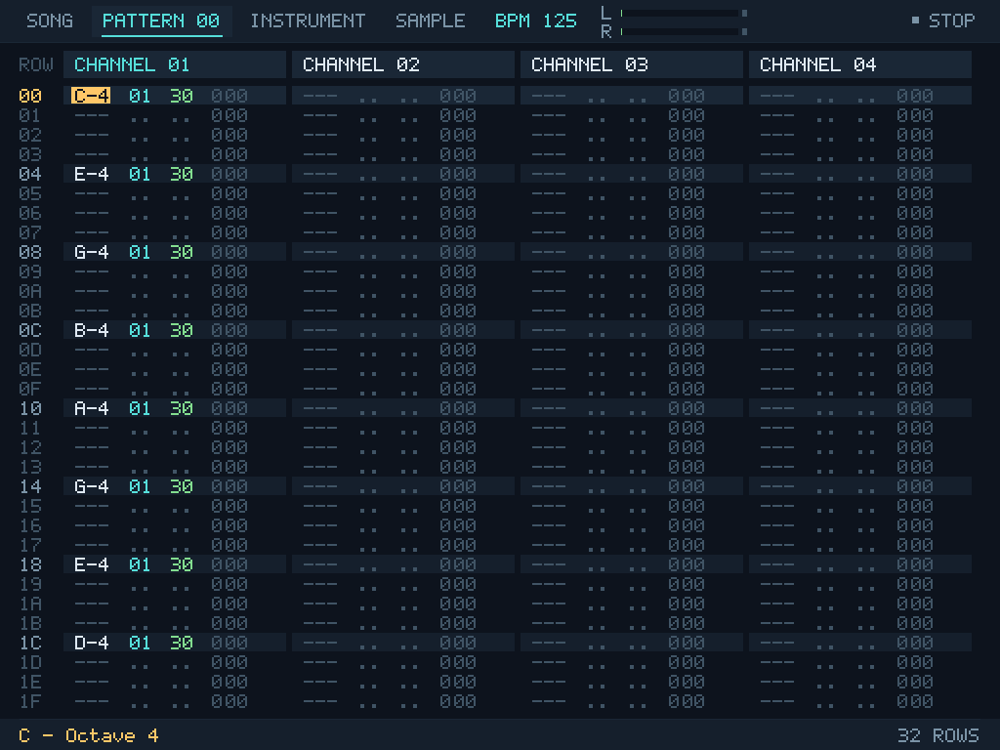

<p></p>

# Little XM Tracker 0.8.0

An open-source XM tracker for composing with a gamepad on TrimUI Brick / KNULLI.
Inspired by the controls of LSDj, M8 and ChooChooTracker, it uses FastTracker II's `.xm` format as its working file.
Written in C++17 with SDL2, using unmodified MilkyPlay sources for playback.

**Release packages target TrimUI Brick / KNULLI.**
See the [user manual](https://yoonsangmin.github.io/little-xm-tracker/) or **Actions → CONTROLS** in the app for controls.
The [manual file](docs/manual.html) is also included in the release and can be opened in a browser offline.



## Features

- Song / Pattern / Instrument / Sample screens, using only D-Pad, A, B, Start and Select.
- XM note, instrument, volume and effect columns; 4/8-channel and 16/32-row views; order arrangement and shared patterns.
- XI multisample instruments, key mapping, volume and panning envelopes, and sample loops.
- WAV, FLAC, MP3 and Ogg Vorbis import, with stereo Blend/Left/Right options and 8/16-bit conversion.
- Sample selection editing, waveform drawing and processing; song rendering to WAV; microphone recording when an input device is available.
- Editing during playback, selection loops, channel Mute/Solo and Undo/Redo.
- Two recovery slots and a backup before manual overwrites. Unused patterns and instruments can be cleaned up separately.
- Name display for Korean, Japanese, Chinese and basic European characters. Name entry uses English letters and numbers.
- Custom RGB themes with load/save/share support and Default, Midnight, Amber and Mono presets.

## Install on Brick

Extract `littlexm-tracker-knulli-brick-arm64.zip` and copy the launcher and application folder into `roms/ports/` on KNULLI SHARE:

```text
roms/ports/
  Little XM Tracker.sh
  xm-tracker/
    littlexm-tracker
    gamecontrollerdb.txt
    assets/
    docs/manual.html
    songs/
    instruments/
    samples/
    themes/
```

Refresh the game list and launch **Ports → Little XM Tracker**.
PortMaster is not required. This package is for KNULLI; Stock and NextUI packages are not provided.
See the included `INSTALL.txt` for installation and troubleshooting details.

| Folder | Contents |
| --- | --- |
| `songs/` | XM songs and rendered song WAVs |
| `instruments/` | XI instruments |
| `samples/` | Sample audio |
| `themes/` | Shared `.theme` files and four bundled presets |
| `userdata/` | Settings and recovery files; created on first launch |

Preserve your files in these five folders when updating. The installation folder remains `xm-tracker/` to keep existing data paths.
Rename the old `XM Tracker.sh` launcher to `Little XM Tracker.sh`.
The app uses KNULLI's device-specific SDL2. Do not replace it with a separate SDL2 library.

## Basic controls

| Button | Action |
| --- | --- |
| D-Pad | Move the cursor or change focus |
| A / A+D-Pad | Enter or confirm / change a value |
| A+B | Cut or clear the current field or selection |
| Select+Left/Right | Change screen |
| Select alone | Cancel a selection, or open Actions when nothing is selected |
| Hold Select, then B | Start, expand or cancel a selection |
| B / Select+A | Copy the selection / paste |
| B+D-Pad | Navigate pages, instruments and samples quickly |
| Start | Start playback for the current screen / stop playback |
| Select+Start | Play from the Pattern cursor row |
| Hold B, then Select / Start | Mute / Solo the current channel |

For button combinations, **press and hold the first button before pressing the second**. B cancels or goes back in dialogs.
The [manual](docs/manual.html) covers each screen and links to effect references.
Edit `gamecontrollerdb.txt` beside the executable to change SDL2 controller mappings. There is no mapping menu in the app.

## Saving and file support

- **SAVE** writes to the current XM file; **SAVE AS** saves under a new name. Before overwriting, the previous file is kept as one backup in a `Backup/` subfolder.
- Autosave is for recovery and does not overwrite your XM file. Recovery uses the newest valid copy from two slots, falling back to the older copy if needed.
- Song, instrument and sample dialogs start in their default folder. Open `../` to go to the parent folder; B cancels. Theme files use only `themes/` beside the executable.
- Reads XM 1.02/1.03/1.04 and writes XM 1.04. Reads and writes XI 1.02.
- Supports 1–32 channels, up to 256 orders and 256 patterns, 1–256 rows per pattern, 128 instruments and 16 samples per instrument.
- XM samples use mono 8/16-bit PCM. Stereo extensions, compressed samples and unknown nonzero extension data are reported as errors.
- Original FT2 supports up to 255 orders. Keep the destination tracker's limits in mind when exchanging files.
- Normal saves preserve unused patterns and instruments. Tracker identification, padding and pattern packing are not preserved byte for byte.
- Song rendering produces 44.1/48 kHz, 16-bit stereo WAV. Sample export produces 16-bit mono WAV.

## Development builds

Release packages are provided for Brick only. Desktop builds are for development and automated tests.
You need a C++17 compiler, CMake 3.24 or later, and SDL2 development files.
MilkyPlay and the audio decoders use pinned versions and SHA256 hashes.

Linux development build:

```sh
bash tools/bootstrap.sh
cmake -S . -B build-linux -DCMAKE_BUILD_TYPE=Release
cmake --build build-linux -j
ctest --test-dir build-linux --output-on-failure
```

`bootstrap.sh` uses `curl` and `unzip` to prepare the pinned source archives. SDL2 comes from your Linux development packages.

Cross-compiling for Brick requires a KNULLI Buildroot SDK or an ABI-compatible A133 SDK with SDL2 development files.

```sh
KNULLI_SDK=/path/to/knulli-sdk \
KNULLI_TARGET=aarch64-buildroot-linux-gnu \
KNULLI_SYSROOT=/path/to/knulli-sdk/aarch64-buildroot-linux-gnu/sysroot \
bash tools/build-brick.sh
```

The package is written to `dist/littlexm-tracker-knulli-brick-arm64.zip`.
Set `QEMU_AARCH64` to run the ARM64 tests. If the SDK's SDL2 lacks dummy drivers, use `tools/prepare-arm64-test-sdl.sh` to prepare a test-only SDL2 and set `QEMU_LIBRARY_PATH` to its library directory.
Test-only SDL2 libraries and QEMU are excluded from release packages.

## Source and licenses

```text
src/model/   XM documents and editing operations
src/io/      XM, XI, WAV, import, saving and recovery
src/audio/   MilkyPlay integration and WAV rendering
src/ui/      SDL2 screens and gamepad editing
src/app/     Application entry point
```

Application code is licensed under [BSD 3-Clause](LICENSE). MilkyPlay sources and app integration are kept separate. When updating the engine, rerun the file, playback and live-editing regression tests.
Third-party code and font licenses, along with pinned versions, are listed in [THIRD_PARTY_NOTICES.txt](THIRD_PARTY_NOTICES.txt) and [licenses/](licenses/).
